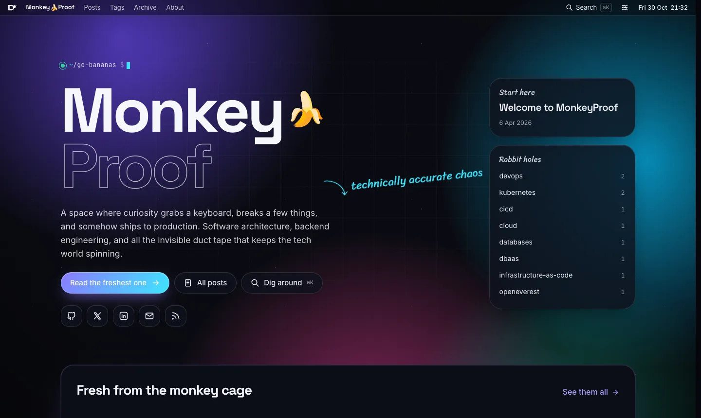
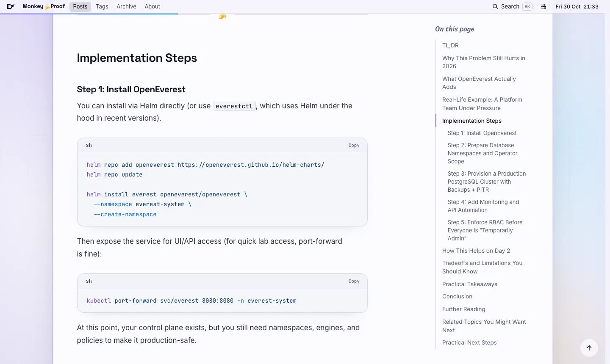
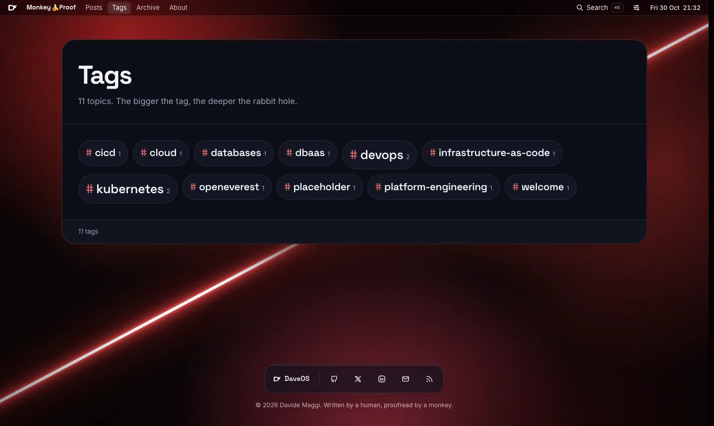

<div align="center">


# Monkey🍌Proof

**Technically accurate chaos.**

The source of [monkeyproof.dev](https://monkeyproof.dev): a blog about software architecture, backend engineering, distributed systems, and the many creative ways production can catch fire.

[](https://astro.build)
[](https://nodejs.org)
[](https://github.com/davidemaggi/MonkeyProof/releases)
[](https://github.com/davidemaggi/MonkeyProof/pkgs/container/monkeyproof)
[](LICENSE)

[**Read the blog**](https://monkeyproof.dev) · [**Visit DaveOS**](https://davidemaggi.dev) · [**RSS**](https://monkeyproof.dev/rss.xml)

<br />



</div>

---

## What is this?

A personal blog where curiosity grabs a keyboard, breaks a few things, and somehow ships to production.

It is written by [Davide Maggi](https://github.com/DavideMaggi), a System Architect with about 20 years of turning coffee into distributed systems. Expect deep dives, experiments, opinions clearly labelled as opinions, and lessons learned the hard way so you don't have to.

The design lives in the same world as **[DaveOS](https://davidemaggi.dev)**, Davide's desktop-in-the-browser portfolio. It has the same aurora wallpapers, glass menu bar, colours, and type, so hopping between the two feels like one place. The blog has its own personality, though: more bananas, more handwriting, fewer window buttons.

<table>
  <tr>
    <td width="50%"></td>
    <td width="50%"></td>
  </tr>
  <tr>
    <td align="center"><sub>Light theme, Pearl wallpaper, a very serious article</sub></td>
    <td align="center"><sub>The Dark Side wallpaper. Yes, it changes the accent too.</sub></td>
  </tr>
</table>

## Features

- 🎨 **DaveOS look**: 7 wallpapers (Aurora, Dark Side, Graphite, Cobalt, Ember, Prism, Pearl), light and dark themes, all picked from a control center in the menu bar.
- 🔁 **Seamless hand-off**: theme and wallpaper travel between monkeyproof.dev and davidemaggi.dev via `?theme=&wallpaper=`.
- 📖 **Built for reading**: a calm 68ch column, an auto-generated "On this page" sidebar with scroll-spy, a reading progress bar, and a focus mode that tells the wallpaper to calm down.
- ✍️ **Handwritten voice**: `*emphasis*` and `.spicy` asides render in Sriracha, and `---` becomes a 🍌 section break.
- 🧑‍💻 **Code that looks good**: Shiki with light/dark themes, file names (`file=foo.ts`), line highlights, word highlights, diffs, and a copy button.
- 🔎 **Search**: full-text search powered by [Pagefind](https://pagefind.app), opened with <kbd>⌘K</kbd>, <kbd>Ctrl K</kbd>, or <kbd>/</kbd>.
- 🖼️ **Galleries**: photo collections with a lightbox, embeddable in MDX posts (feature-flagged).
- 🎧 **Lofi radio**: an optional player that keeps playing while you read (feature-flagged).
- 🃏 **Social cards**: Open Graph images generated per post, in the same aurora style.
- 📡 **The boring-but-important bits**: RSS, sitemap, robots.txt, JSON-LD, share links, tags, an archive.

## Quick start

You need **Node ≥ 22.23.4** (Astro 7). The repo pins Node 24 in `.nvmrc`.

```sh
git clone https://github.com/davidemaggi/MonkeyProof.git
cd MonkeyProof
nvm use          # or: nvm install 24
npm ci
npm run dev      # http://localhost:4321
```

| Command | What it does |
| --- | --- |
| `npm run dev` | Dev server. Drafts are visible here and only here. |
| `npm run build` | `astro check` + static build + Pagefind index |
| `npm run preview` | Serves `dist/` |
| `npm run lint` / `npm run format` | ESLint / Prettier |
| `npm run sync` | Regenerates Astro content types |

> Search only works after `npm run build`, because the index is generated from the built site.

## Writing a post

Drop a Markdown (or MDX) file into `src/data/blog/`:

```md
---
title: "Do You Really Need to Master Kubernetes for DevOps?"
description: "Why cloud, CI/CD, and IaC matter more than deep Kubernetes for most roles."
pubDatetime: 2026-04-09T22:36:00Z
tags: [devops, kubernetes]
draft: true
mainImage: ../../assets/images/choice.png
mainImageAlt: A DevOps engineer choosing between technology paths
mainImageCaption: Not every DevOps journey starts with Kubernetes.
---

## TL;DR

Spoiler: *not really.*
```

- The schema lives in `src/content.config.ts`. `title`, `description`, `pubDatetime`, and `tags` are required.
- `featured: true` pins a post in the home widget.
- Headings build the sidebar automatically, so there is no need for a manual table of contents.
- In-article images go in `public/images/`. The cover (`mainImage`) goes in `src/assets/images/`, where Astro optimizes it.
- Social card priority: `mainImage` → `ogImage` → generated card → site default.

Writing with Claude Code? The `monkeyproof-writing` skill in `.claude/skills/` knows the voice, the structure, and the frontmatter rules.

## Configuration

Everything you're likely to toggle lives in `src/config.ts`:

| Setting | What it does |
| --- | --- |
| `appearance.theme` / `appearance.wallpaper` | Defaults for first-time visitors |
| `daveos.url` | Where the menu bar logo takes you |
| `showArchives`, `showGalleries`, `showGalleriesInIndex` | Feature flags |
| `introAudio` | The lofi radio: enable it and set the stream or file |
| `editPost` | "Edit this post" link to GitHub |
| `postPerIndex`, `postPerPage`, `timezone`, `lang` | Exactly what they sound like |

Galleries are documented in [`GALLERIES.md`](GALLERIES.md). Design tokens and rules are in [`DESIGN.md`](DESIGN.md).

## Project map

```text
src/
├── components/   menu bar, panels, post rows, search, lightbox, audio…
├── layouts/      base layout, article layout, about layout
├── pages/        routes: /, /posts, /tags, /archives, /galleries, /about, rss, og images
├── data/blog/    the posts (the actual point of all this)
├── styles/       global tokens + wallpapers, reading typography
├── scripts/      theme/wallpaper/focus prefs, DaveOS hand-off, clock
└── utils/        sorting, slugs, dates, OG cards, the Shiki code-block transformer
```

## Release & deploy

Releases are fully automated by [semantic-release](https://semantic-release.gitbook.io) in `.github/workflows/docker-build-push.yml`. On every push to `main`:

1. The next version is computed from the commit messages, and a `vX.Y.Z` tag, GitHub release, and `CHANGELOG.md` entry are created.
2. A Docker image (nginx serving the static site) is pushed to `ghcr.io/davidemaggi/monkeyproof` with the tags `X.Y.Z`, `vX.Y.Z`, and `latest`.

Use [Conventional Commits](https://www.conventionalcommits.org): `fix:` → patch, `feat:` → minor, `feat!:` / `BREAKING CHANGE:` → major. Don't create tags by hand; the robot gets jealous.

Run it locally:

```sh
docker compose up --build   # http://localhost:8080
```

## Troubleshooting

- **`EBADENGINE` or "Node.js vX is not supported by Astro"**: run `nvm use 24`.
- **Search says the index was not found**: run `npm run build` first. In dev mode there is no index.
- **A post doesn't show up**: check that it isn't `draft: true` and that `pubDatetime` isn't in the future (scheduled posts appear 15 minutes before their time).

## License

[MIT](LICENSE). The bananas are free.
