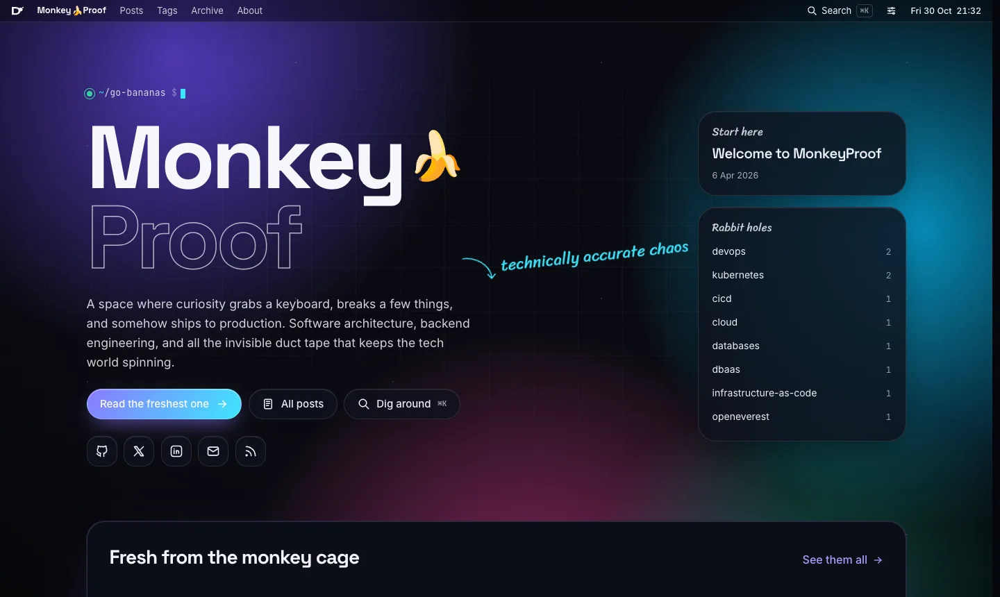
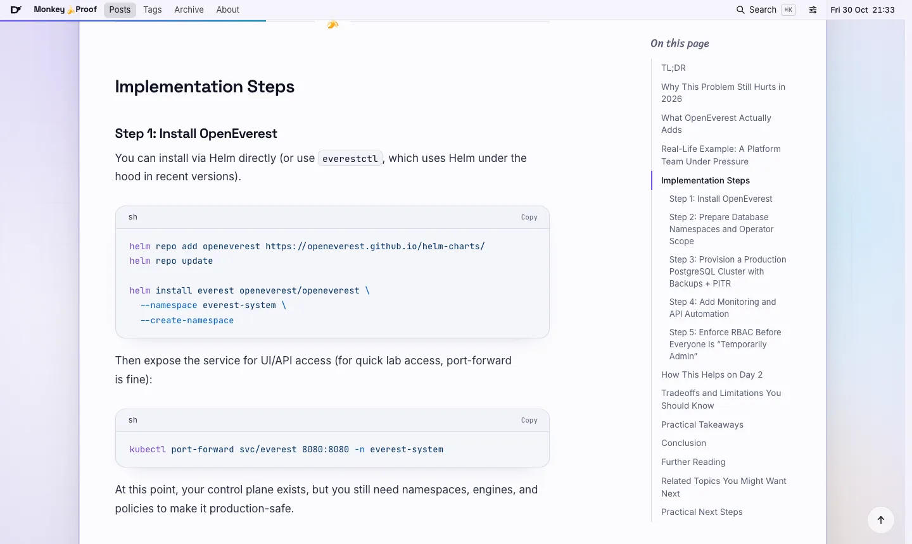
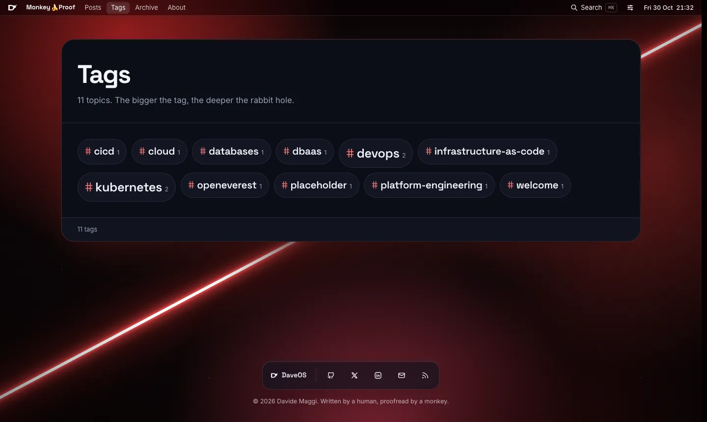

<div align="center">


# Monkey🍌Proof

**Technically accurate chaos.**

The source of [monkeyproof.dev](https://monkeyproof.dev): a blog about software architecture, backend engineering, distributed systems, and the many creative ways production can catch fire.

[](https://astro.build)
[](https://nodejs.org)
[](https://github.com/davidemaggi/MonkeyProof/releases)
[](https://github.com/davidemaggi/MonkeyProof/pkgs/container/monkeyproof)
[](LICENSE)

[**Read the blog**](https://monkeyproof.dev) · [**Visit DaveOS**](https://davidemaggi.dev) · [**RSS**](https://monkeyproof.dev/rss.xml)

<br />



</div>

---

## What is this?

A personal blog where curiosity grabs a keyboard, breaks a few things, and somehow ships to production.

It is written by [Davide Maggi](https://github.com/DavideMaggi), a System Architect with about 20 years of turning coffee into distributed systems. Expect deep dives, experiments, opinions clearly labelled as opinions, and lessons learned the hard way so you don't have to.

The design lives in the same world as **[DaveOS](https://davidemaggi.dev)**, Davide's desktop-in-the-browser portfolio. It has the same aurora wallpapers, glass menu bar, colours, and type, so hopping between the two feels like one place. The blog has its own personality, though: more bananas, more handwriting, fewer window buttons.

<table>
  <tr>
    <td width="50%"></td>
    <td width="50%"></td>
  </tr>
  <tr>
    <td align="center"><sub>Light theme, Pearl wallpaper, a very serious article</sub></td>
    <td align="center"><sub>The Dark Side wallpaper. Yes, it changes the accent too.</sub></td>
  </tr>
</table>

## Features

- 🎨 **DaveOS look**: 7 wallpapers (Aurora, Dark Side, Graphite, Cobalt, Ember, Prism, Pearl), light and dark themes, all picked from a control center in the menu bar.
- 🔁 **Seamless hand-off**: theme and wallpaper travel between monkeyproof.dev and davidemaggi.dev via `?theme=&wallpaper=`.
- 📖 **Built for reading**: a calm 68ch column, an auto-generated "On this page" sidebar with scroll-spy, a reading progress bar, and a focus mode that tells the wallpaper to calm down.
- ✍️ **Handwritten voice**: `*emphasis*` and `.spicy` asides render in Sriracha, and `---` becomes a 🍌 section break.
- 🧑‍💻 **Code that looks good**: Shiki with light/dark themes, file names (`file=foo.ts`), line highlights, word highlights, diffs, and a copy button.
- 🔎 **Search**: full-text search powered by [Pagefind](https://pagefind.app), opened with <kbd>⌘K</kbd>, <kbd>Ctrl K</kbd>, or <kbd>/</kbd>.
- 🖼️ **Galleries**: photo collections with a lightbox, embeddable in MDX posts (feature-flagged).
- 🎧 **Lofi radio**: an optional player that keeps playing while you read (feature-flagged).
- 🃏 **Social cards**: Open Graph images generated per post, in the same aurora style.
- 📡 **The boring-but-important bits**: RSS, sitemap, robots.txt, JSON-LD, share links, tags, an archive.

## Quick start

You need **Node ≥ 22.23.4** (Astro 7). The repo pins Node 24 in `.nvmrc`.

```sh
git clone https://github.com/davidemaggi/MonkeyProof.git
cd MonkeyProof
nvm use          # or: nvm install 24
npm ci
npm run dev      # http://localhost:4321
```

| Command | What it does |
| --- | --- |
| `npm run dev` | Dev server. Drafts are visible here and only here. |
| `npm run build` | `astro check` + static build + Pagefind index |
| `npm run preview` | Serves `dist/` |
| `npm run lint` / `npm run format` | ESLint / Prettier |
| `npm run sync` | Regenerates Astro content types |

> Search only works after `npm run build`, because the index is generated from the built site.

## Writing a post

Drop a Markdown (or MDX) file into `src/data/blog/`:

```md
---
title: "Do You Really Need to Master Kubernetes for DevOps?"
description: "Why cloud, CI/CD, and IaC matter more than deep Kubernetes for most roles."
pubDatetime: 2026-04-09T22:36:00Z
tags: [devops, kubernetes]
draft: true
mainImage: ../../assets/images/choice.webp
mainImageAlt: A DevOps engineer choosing between technology paths
mainImageCaption: Not every DevOps journey starts with Kubernetes.
---

## TL;DR

Spoiler: *not really.*
```

- The schema lives in `src/content.config.ts`. `title`, `description`, `pubDatetime`, and `tags` are required.
- `featured: true` pins a post in the home widget.
- Headings build the sidebar automatically, so there is no need for a manual table of contents.
- In-article images go in `public/images/`. The cover (`mainImage`) goes in `src/assets/images/`, where Astro optimizes it.
- Social card priority: `mainImage` → `ogImage` → generated card → site default.

Writing with Claude Code? The `monkeyproof-writing` skill in `.claude/skills/` knows the voice, the structure, and the frontmatter rules.

## Sharing a post on social media

New posts are promoted through a self-hosted [n8n](https://n8n.io) workflow, **MonkeyProof Social Publisher**, at `https://n8n.davidemaggi.dev/workflow/n5aQBb7qUK6Bgncy`. One authenticated webhook call publishes to every channel listed in the payload. Each channel runs on its own branch, so if one fails the others still post.

| Channel | How it's published |
| --- | --- |
| LinkedIn (personal profile) | Automatically by the workflow: text, native image, and a first comment with the link |
| LinkedIn (MonkeyProof Page) | By hand: open the post, **Repost**, switch identity to the Page |
| X | By hand: the X API is pay-per-use (no free tier since February 2026), so the "Post on X" node is disabled |

> The easy way: ask Claude Code to share the post. The `monkeyproof-social` skill in `.claude/skills/` writes the copy, waits for your OK, makes the image, and calls the webhook.

### Doing it by hand

**1. Secrets.** Create `.env` in the repo root (it's gitignored). The secret is the value of the n8n credential "MonkeyProof Social Webhook":

```sh file=.env
MONKEYPROOF_SOCIAL_WEBHOOK_URL=https://n8n.davidemaggi.dev/webhook/monkeyproof-social
MONKEYPROOF_SOCIAL_WEBHOOK_HEADER=X-MonkeyProof-Key
MONKEYPROOF_SOCIAL_WEBHOOK_SECRET=<secret>
```

**2. Social image.** LinkedIn's API rejects WebP, so convert the cover to JPG, commit it, and push. The raw GitHub URL works right after the push, without waiting for a release:

```sh
magick src/assets/images/<slug>.webp -strip -quality 85 public/social/<slug>.jpg
git add public/social/<slug>.jpg && git commit -m "chore(social): add <slug> social image" && git push
# → https://raw.githubusercontent.com/davidemaggi/MonkeyProof/main/public/social/<slug>.jpg
```

**3. Payload.** Write the post text in a file and let `jq` build the JSON, so quotes and newlines are escaped for you. Keep the link out of the LinkedIn body (it hurts reach) and put it in `firstComment`:

```sh
mkdir -p /tmp/mp-social
$EDITOR /tmp/mp-social/linkedin.txt

jq -n \
  --rawfile li /tmp/mp-social/linkedin.txt \
  --arg img "https://raw.githubusercontent.com/davidemaggi/MonkeyProof/main/public/social/<slug>.jpg" \
  --arg comment "Full article: https://monkeyproof.dev/posts/<slug>" \
  '{channels:["linkedin"], linkedin:{text:($li|rtrimstr("\n")), imageUrl:$img, firstComment:$comment}}' \
  > /tmp/mp-social/payload.json
```

The full payload shape is below. Leave a channel out of `channels` to skip it. `imageUrl` and `firstComment` are optional:

```json file=payload.json
{
  "channels": ["linkedin"],
  "linkedin": { "text": "Post body", "imageUrl": "https://…/<slug>.jpg", "firstComment": "Full article: https://monkeyproof.dev/posts/<slug>" },
  "x": { "text": "Hook line https://monkeyproof.dev/posts/<slug>" }
}
```

Write the post text as plain text, hashtags included (`#SRE #AI`). The workflow escapes the characters LinkedIn reserves and turns `#word` into real hashtags.

**4. Trigger it.** This publishes for real, and it can't be undone, so send it once:

```sh
set -a; source .env; set +a
curl -sS -X POST "$MONKEYPROOF_SOCIAL_WEBHOOK_URL" \
  -H "$MONKEYPROOF_SOCIAL_WEBHOOK_HEADER: $MONKEYPROOF_SOCIAL_WEBHOOK_SECRET" \
  -H "Content-Type: application/json" \
  --data @/tmp/mp-social/payload.json
```

The webhook answers `{"message":"Workflow was started"}` right away, before anything is posted. The real result is in the n8n **Executions** tab. To check the webhook and the secret without posting anything, send `{"channels":[]}`. You should get a 200, or a 403 if the secret is wrong.

**5. Afterwards.** Repost the LinkedIn post as the MonkeyProof Page, and paste the X copy on x.com.

### What the workflow does

```text
Social Post Request (webhook, header auth)
├─ LinkedIn Requested?
│  └─ Get LinkedIn Member          GET /v2/userinfo → member id
│     └─ Prepare LinkedIn Post     author URN, escaped text, hashtags
│        └─ LinkedIn Has Image?
│           ├─ yes: Init LinkedIn Image Upload → Download Post Image → Upload LinkedIn Image → LinkedIn Post With Image
│           └─ no:  LinkedIn Post Text Only
│              └─ Has First Comment? → Add LinkedIn First Comment
└─ X Requested? → Post on X (disabled)
```

- LinkedIn is called directly through HTTP Request nodes on the REST API (`/rest/images`, `/rest/posts`), with the headers `LinkedIn-Version: 202609` and `X-Restli-Protocol-Version: 2.0.0`. The built-in n8n LinkedIn node can't be used: it sends an API version LinkedIn has retired.
- The post's URN comes back in the `x-restli-id` response header and is used to attach the first comment.
- Credentials in n8n: "MonkeyProof Social Webhook" (Header Auth) and "LinkedIn account" (LinkedIn OAuth2, Organization Support off). The LinkedIn app has the "Share on LinkedIn" and "Sign In with LinkedIn using OpenID Connect" products. "X" (X OAuth2) isn't configured.
- The workflow must be **published (active)**, or the production URL answers 404.

### When it breaks

| Symptom | Cause and fix |
| --- | --- |
| `404 webhook not registered` | The workflow isn't published. Publish it in n8n. |
| `403` from the webhook | Wrong secret or header name in `.env`. |
| `401` on a LinkedIn node | The LinkedIn token expired (it lasts about 60 days). Reconnect "LinkedIn account" in n8n. |
| `426 NONEXISTENT_VERSION` | That `LinkedIn-Version` has been retired (each one lasts about a year). Bump it in every LinkedIn HTTP node. |
| `403 partnerApiSocialActions.CREATE` on the first comment | The versioned `/rest/socialActions` endpoint needs LinkedIn partner access. The post is already live: add the comment by hand and don't resend. Fix: change the node URL to `https://api.linkedin.com/v2/socialActions/…/comments` and turn off its headers (still to do). |
| Nodes lose their credential after editing the workflow through the n8n MCP | Expected: MCP updates don't keep credentials on HTTP Request nodes. Reassign "LinkedIn account" to all six LinkedIn HTTP nodes, then publish. |

## Configuration

Everything you're likely to toggle lives in `src/config.ts`:

| Setting | What it does |
| --- | --- |
| `appearance.theme` / `appearance.wallpaper` | Defaults for first-time visitors |
| `daveos.url` | Where the menu bar logo takes you |
| `showArchives`, `showGalleries`, `showGalleriesInIndex` | Feature flags |
| `introAudio` | The lofi radio: enable it and set the stream or file |
| `editPost` | "Edit this post" link to GitHub |
| `postPerIndex`, `postPerPage`, `timezone`, `lang` | Exactly what they sound like |

Galleries are documented in [`GALLERIES.md`](GALLERIES.md). Design tokens and rules are in [`DESIGN.md`](DESIGN.md).

## Project map

```text
src/
├── components/   menu bar, panels, post rows, search, lightbox, audio…
├── layouts/      base layout, article layout, about layout
├── pages/        routes: /, /posts, /tags, /archives, /galleries, /about, rss, og images
├── data/blog/    the posts (the actual point of all this)
├── styles/       global tokens + wallpapers, reading typography
├── scripts/      theme/wallpaper/focus prefs, DaveOS hand-off, clock
└── utils/        sorting, slugs, dates, OG cards, the Shiki code-block transformer
```

## Release & deploy

Releases are fully automated by [semantic-release](https://semantic-release.gitbook.io) in `.github/workflows/docker-build-push.yml`. On every push to `main`:

1. The next version is computed from the commit messages, and a `vX.Y.Z` tag, GitHub release, and `CHANGELOG.md` entry are created.
2. A Docker image (nginx serving the static site) is pushed to `ghcr.io/davidemaggi/monkeyproof` with the tags `X.Y.Z`, `vX.Y.Z`, and `latest`.

Use [Conventional Commits](https://www.conventionalcommits.org): `fix:` → patch, `feat:` → minor, `feat!:` / `BREAKING CHANGE:` → major. Don't create tags by hand; the robot gets jealous.

Run it locally:

```sh
docker compose up --build   # http://localhost:8080
```

## Troubleshooting

- **`EBADENGINE` or "Node.js vX is not supported by Astro"**: run `nvm use 24`.
- **Search says the index was not found**: run `npm run build` first. In dev mode there is no index.
- **A post doesn't show up**: check that it isn't `draft: true` and that `pubDatetime` isn't in the future (scheduled posts appear 15 minutes before their time).

## License

[MIT](LICENSE). The bananas are free.
